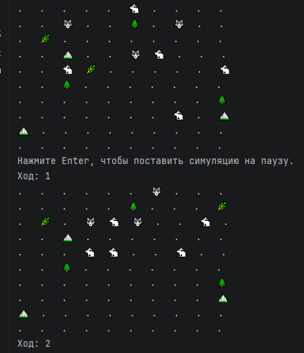
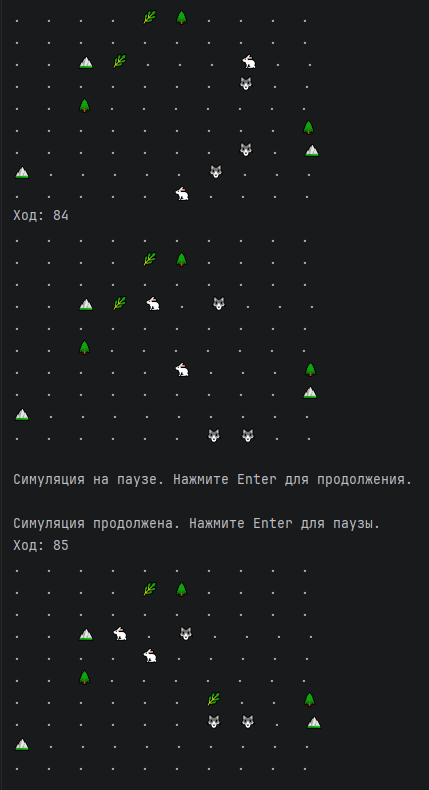

# Симуляция

Консольная пошаговая симуляция 2D-мира, населённого существами и статическими объектами.

Учебный проект для практики объектно-ориентированного программирования, поиска пути и взаимодействия сущностей на Java.

## Возможности

- генерация карты со случайным размещением сущностей;
- травоядные ищут ближайшую траву и перемещаются к ней;
- хищники ищут и атакуют травоядных;
- поиск пути выполняется алгоритмом BFS с учётом препятствий;
- существа перемещаются с учётом своей скорости;
- после каждого хода поддерживается минимальное количество травы и травоядных;
- симуляцию можно поставить на паузу и продолжить с того же состояния;
- состояние мира отображается в консоли после каждого хода.

## Архитектура

Проект разделён на несколько пакетов по зонам ответственности:

- `model` — сущности мира, координаты и карта;
- `action` — создание и выполнение действий, первоначальное размещение сущностей и поддержание популяций;
- `engine` — жизненный цикл симуляции, выполнение ходов и счётчик ходов;
- `pathfinding` — поиск кратчайшего пути к цели с помощью алгоритма BFS;
- `view` — отображение состояния карты в консоли;
- `app` — точка входа, настройка зависимостей и обработка пользовательских команд.

Основные компоненты:

- `Main` — создаёт необходимые зависимости и запускает приложение;
- `SimulationController` — обрабатывает команды паузы и продолжения;
- `ActionFactory` — формирует наборы действий для инициализации и каждого хода;
- `Simulation` — выполняет действия, управляет ходами и обновляет отображение карты;
- `MapRenderer` — выводит карту и спрайты сущностей в консоль.

## Технологии

- Java 26
- Maven

## Запуск

Для запуска проекта необходима Java 26.

1. Клонируйте репозиторий.
2. Откройте проект в IntelliJ IDEA.
3. Запустите метод `main()` из класса `app.Main`.

## Управление

Нажмите Enter, чтобы поставить симуляцию на паузу. Нажмите Enter ещё раз, чтобы продолжить.

## Пример работы

Обычная работа симуляции:

Пауза и продолжение симуляции:

## Сущности

В симуляции используются следующие типы сущностей:

- `Grass` — ресурс для травоядных;
- `Herbivore` — ищет и поедает траву;
- `Predator` — преследует и атакует травоядных;
- `Rock` и `Tree` — статические препятствия.

Каждый ход существа выполняют действия, после чего система при необходимости восстанавливает минимальное количество травы и травоядных.

